# ⚡ Awesome Agile Project Management

  

  
  
  
  
  
  
  

---

## 🎯 Overview & Scope

A curated directory and comparison guide of the world's top **Agile Project Management platforms**, **Scrum & Kanban tools**, **issue trackers**, and **open-source self-hostable alternatives**. 

Whether your engineering team practices pure **Scrum**, **Kanban**, **Scrumban**, or enterprise-scaled frameworks like **SAFe®**, this guide provides verifiable data on pricing models, free-tier limits, company scale, and GitHub open-source community engagement.

*Last updated: October 2026*

---

## 📑 Table of Contents

- [📊 Sector Overview & Market Dynamics](#-sector-overview--market-dynamics)
- [☁️ SaaS/Hosted Platforms](#️-saashosted-platforms)
- [🔓 Open-Source GitHub Projects](#-open-source-github-projects)
- [📈 Star History](#-star-history)
- [🤝 How to Contribute](#-how-to-contribute)
- [💖 Support](#-support)
- [📜 Disclaimer](#-disclaimer)

---

## 📊 Sector Overview & Market Dynamics

The global **Agile Project Management Software** market is valued at approximately **$6.1B – $6.8B in 2026** (part of the broader $11B+ project management software ecosystem) and is expanding at an estimated **CAGR of 13% – 14.1%**, projected to exceed **$17B+ by the early 2030s**.

The sector exhibits **moderate fragmentation with an oligopolistic tier at the top**: enterprise and cross-tool infrastructure remain concentrated among entrenched mega-caps (Microsoft Azure DevOps, Atlassian Jira, Broadcom Rally), while modern developer-experience platforms (Linear, ClickUp, Monday Dev) and community-driven, privacy-centric open-source engines (Plane, Focalboard, Planka, Taiga) actively capture substantial market share, preventing a single winner-take-all monopoly.

---

## ☁️ SaaS/Hosted Platforms

| 🏢 Platform | 💰 Company Size (Market Cap / Valuation / ARR) | 🏷️ Starting Price | 🎁 Free Tier / Trial Limits | 📝 Description |
| :--- | :--- | :--- | :--- | :--- |
| **[Azure DevOps](https://azure.microsoft.com/en-us/products/devops)** | ~$3.1T Market Cap (Microsoft) | $6/user/month (Basic Plan) | Free forever for up to 5 users (includes Azure Boards, unlimited private Git repos, and 1 free parallel CI/CD job with 1,800 build mins/month) | Microsoft’s integrated suite for agile planning, work item tracking, pipelines, repos, and test management tightly coupled with the Microsoft ecosystem. |
| **[Rally](https://www.broadcom.com/products/software/agile-development/rally)** | ~$800B+ Market Cap (Broadcom) | ~$15–$35/user/month (Enterprise quote-based) | Free forever for up to 50 users (via Rally Starter Edition with SAFe portfolio & program planning support) or 90-day enterprise evaluation POC | Enterprise agile platform (formerly CA Agile Central / Rally) focused on portfolio and program-level agile planning and tracking. |
| **[Targetprocess](https://www.targetprocess.com/)** | ~$200B+ Market Cap (IBM Apptio) | ~£12–£32 (~$15–$40)/user/month (Min 10 users, annual contract) | Custom sales-assisted free trial / sandbox proof-of-concept (typically 14–30 days upon request, no instant self-serve free plan) | Visual agile project management tool designed for scaling Scrum, Kanban, and SAFe-style practices with highly customizable boards and hierarchies. |
| **[Jira Software](https://www.atlassian.com/software/jira)** | ~$45B+ Market Cap (Atlassian) | $7.16/user/month (Standard, billed annually) or $8.15/user/month (billed monthly) | Free forever for up to 10 users with 2 GB storage, Scrum/Kanban boards, and standard backlog management | Industry-standard agile project management and issue tracking platform from Atlassian with deep Scrum/Kanban support, workflows, and extensive ecosystem integrations. |
| **[Monday Dev](https://monday.com/dev)** | ~$12B+ Market Cap (monday.com) | $12/seat/month (Standard Dev, billed annually; min 3 seats) | Free forever for up to 2 seats (up to 3 boards, 200+ templates, 500 MB storage; or 14-day Pro trial with all features) | Developer-focused offering from monday.com tailored for software delivery, sprints, and engineering workflows on top of the monday.com platform. |
| **[Asana](https://asana.com/)** | ~$3B+ Market Cap (Asana, Inc.) | $10.99/user/month (Starter, billed annually) or $13.49/user/month (billed monthly) | Free forever (Personal plan) for up to 10 teammates with unlimited tasks, projects, messages, and 100MB file attachments | Work management platform supporting tasks, projects, timelines, and portfolios; frequently used for agile and cross-functional team coordination. |
| **[Linear](https://linear.app/)** | $2.5B Valuation (~$100M+ ARR) | $8/user/month (Standard, billed annually) or $10/user/month (billed monthly) | Free forever for unlimited members with a cap of 250 active issues and 10MB file upload limit | Modern, fast issue tracking and project management tool designed for high-performance software teams with streamlined UI and strong keyboard-driven workflows. |
| **[ClickUp](https://clickup.com/)** | ~$4B Valuation (~$150M+ ARR) | $7/user/month (Unlimited, billed annually) or $10/user/month (billed monthly) | Free forever for unlimited members with 100MB storage, 100 uses of custom fields, and 100 uses of Gantt charts | All-in-one productivity and project management platform with flexible views (list, board, Gantt, etc.) widely used for agile and hybrid team workflows. |
| **[VersionOne](https://www.collab.net/products/versionone)** | ~$150M–$250M ARR (Digital.ai / TPG) | ~$29/user/month (Base Enterprise edition quote-based) | Quote-based enterprise evaluation sandbox / guided PoC only (no self-serve free forever plan) | Enterprise agile management suite (now Digital.ai Agility) supporting Scrum, Kanban, and scaled agile practices across teams and programs. |
| **[Shortcut](https://www.shortcut.com/)** | ~$100M Valuation (~$21M ARR) | $8.50/user/month (Team, billed annually) or $10/user/month (billed monthly) | Free forever for up to 5 users with full core features, unlimited docs, and integrations (or 14-day free trial on Team/Business tiers) | Agile project management platform (formerly Clubhouse) focused on software teams with stories, epics, iterations, and clean collaboration features. |

---

## 🔓 Open-Source GitHub Projects

Curated self-hostable agile engines and task management tools, **sorted by GitHub stargazers (descending)**:

1. **[Plane](https://github.com/makeplane/plane)**   
   Modern open-source software development tool and issue tracker built as an extensible, privacy-friendly alternative to Jira and Linear with cycles, modules, pages, and time tracking.

2. **[Focalboard](https://github.com/mattermost/focalboard)**   
   Open-source, multilingual project management suite from Mattermost providing Kanban boards, tables, galleries, and calendar views for agile teams.

3. **[Super Productivity](https://github.com/super-productivity/super-productivity)**   
   Advanced open-source agile ToDo list and time tracking tool designed for engineers, integrating directly with Jira, GitHub, and GitLab.

4. **[WeKan](https://github.com/wekan/wekan)**   
   Open-source Kanban board application modeled after Trello, supporting self-hosting, subtasks, swimlanes, custom fields, and role-based permissions.

5. **[OpenProject](https://github.com/opf/openproject)**   
   Enterprise-ready open-source management software featuring agile boards, work packages, interactive Gantt charts, roadmaps, and enterprise security.

6. **[Planka](https://github.com/plankanban/planka)**   
   Real-time collaborative Kanban board built with React and Redux, featuring custom backgrounds, user story assignments, and attachment management.

7. **[Leantime](https://github.com/Leantime/leantime)**   
   Open-source project management platform tailored for startup and product innovation teams, combining lean canvases, milestones, and Scrum boards.

8. **[Kanboard](https://github.com/kanboard/kanboard)**   
   Minimalist, lightning-fast Kanban software focused on simplicity, WIP (Work-in-Progress) limits, automated actions, and lightweight PHP deployment.

9. **[Taskbook](https://github.com/klaussinani/taskbook)**   
   Terminal-first task and board manager for developers who prefer command-line agile workflows, boards, priorities, and scratchpad notes.

10. **[Ever Gauzy](https://github.com/ever-co/ever-gauzy)**   
    Open-source business management, agile project tracking, time tracking, and ERP platform suited for agencies and cross-functional teams.

11. **[Redmine](https://github.com/redmine/redmine)**   
    Battle-tested open-source issue tracking and project management framework written in Ruby on Rails, featuring custom fields, role-based access, and Gantt charts.

12. **[Vikunja](https://github.com/go-vikunja/vikunja)**   
    Modern self-hostable to-do and project management application built with Go and Vue, supporting Kanban views, subtasks, deadlines, and relation graphs.

13. **[Taiga](https://github.com/taigaio/taiga-front)**   
    Celebrated open-source agile project management platform for Scrum and Kanban enthusiasts, featuring user story estimation, sprint burndown charts, and epics.

14. **[Nextcloud Deck](https://github.com/nextcloud/deck)**   
    Kanban-style task and project tracking app integrated directly into Nextcloud for sovereign, self-hosted team collaboration.

---

## 📈 Star History

---

## 🤝 How to Contribute

Contributions are warmly welcomed! To suggest a new tool or update an existing one:

1. 🍴 Fork the repository.
2. 🌿 Create a branch for your update (`git checkout -b feature/add-agile-tool`).
3. 📝 Add or edit entries in [`README.md`](README.md):
   - Keep SaaS entries with verifiable starting prices and free tier constraints.
   - For open-source tools, include the repository URL, description, and stargazer badge.
4. 🚀 Submit a Pull Request with a clear description of changes.

---

## 💖 Support

Thank you so much for exploring this ecosystem guide! 🌟  

If you find this repository valuable:
- ⭐ **Star this repository** to help others discover it.
- 🍴 **Fork it** to customize it for your organization.
- 📢 **Share it** with fellow engineering managers, agile coaches, and developers.
- ☕ **Buy a coffee & sponsor ongoing maintenance:** [Sponsor Dashboard on GitHub](https://github.com/sponsors/ishandutta2007)

---

## 📜 Disclaimer

- This list is community-curated for informational and architectural comparison purposes.
- Mentions do not constitute official endorsements or commercial sponsorships.
- Always review security, data governance, and SLA requirements before deploying production self-hosted or SaaS agile systems.

---

  <b>Made with ❤️ for agile coaches, engineering managers, and open-source project teams worldwide.</b>

